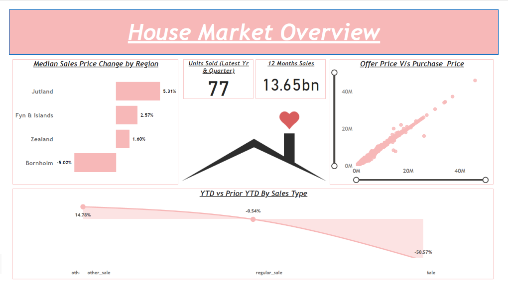
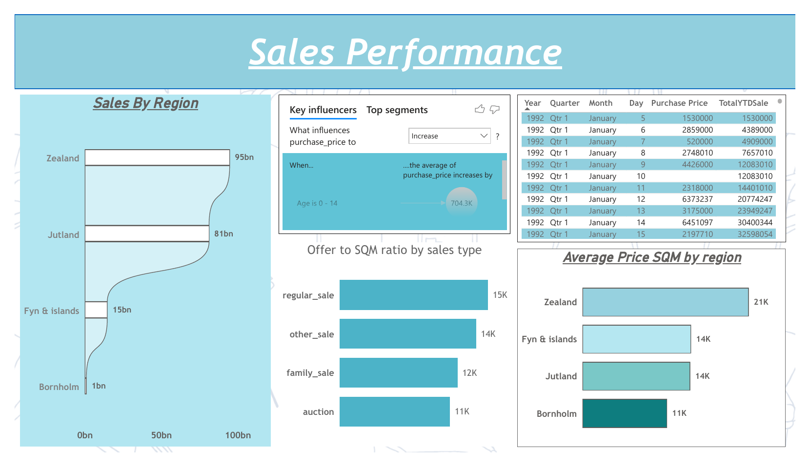
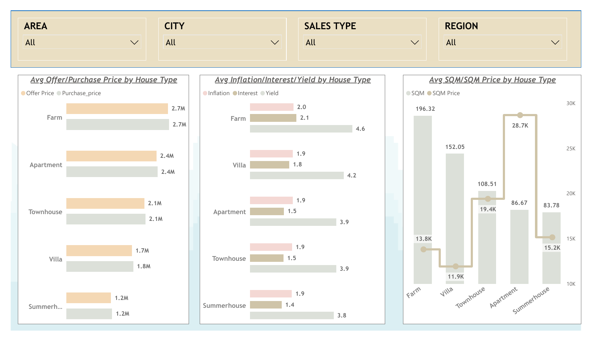

# Housing Market Analysis | SQL & Power BI

Analysis of 100,000 housing transaction records, combining a three-page Power BI report with BigQuery SQL for data-quality checks, KPI validation and regional comparisons.

**Author:** Gaurav Malhotra  
**Tools:** Power BI Desktop, Power Query, DAX, Google BigQuery (GoogleSQL)  
**Coverage:** 5 January 1992–24 October 2024

## Explore the project

- [Power BI report (.pbix)](report/Housing_Market_Analysis.pbix) — download and open in Power BI Desktop.
- [View the report as PDF](report/Housing_Market_Analysis.pdf) — all three pages, no Power BI installation needed.
- [SQL case study](sql/analysis.md) — ten questions, queries, outputs and findings.
- [Runnable SQL](sql/queries.sql) — the same ten queries in one script.
- [Source Housing CSV](data/Housing.csv).
- [Current DAX formulas](docs/dax-formulas.md).
- [Methodology, source and limitations](docs/methodology.md).

The PBIX contains imported data for exploring the saved report. Refreshing requires access to a configured BigQuery source. This repository does not provide a Power BI Service link.

## Dashboard preview

Static previews from the exported Power BI report. Download the PBIX to use slicers and interactions.

### House Market Overview

Sales Performance

House Type Analysis

## Questions explored

1. Are the IDs, dates, property ages and economic fields suitable for reporting?
2. How does sales value change when equivalent year-to-date periods are compared?
3. Which regions account for the largest transaction counts and sales values?
4. Which eligible house types have the highest average price per square metre within each region?

## Main findings

| Finding | Result | Scope |
| --- | --- | --- |
| Sales-value change | **−2.54%** | 1 January–24 October 2024 versus the same dates in 2023 |
| Largest sales-value share | **Zealand: 49.31%** | Full historical dataset |
| Most transactions | **Jutland: 49,937** | Full historical dataset |
| Highest-ranked eligible house type by average price/m² | **Apartment** in Zealand, Jutland and Fyn & islands | 2024 through 24 October; at least 30 transactions per group |
| Property-age anomalies | **6,505 records** | Construction year later than sale year |

Comparing partial 2024 with all of 2023 would produce a misleading **−24.21%** change. Matching the date windows changes the interpretation substantially. These findings describe this dataset, not the entire housing market.

## Report pages

| Page | Content |
| --- | --- |
| House Market Overview | YTD growth comparisons, latest-quarter units, rolling sales and offer/purchase comparison |
| Sales Performance | Regional sales, price/m², cumulative YTD sales and property-age associations |
| House Type Analysis | House-type comparisons and area, city, sales-type and region slicers |

## Workflow and changes

- Loaded the Housing dataset into BigQuery and connected Power BI to the table.
- Used Power Query to assign `Unknown` to 11 missing city values and set the sale-date type.
- Preserved missing economic values: both inflation and mortgage bond yield are missing for all 77 October 2024 transactions.
- Treated negative property ages as blank, retaining the underlying transactions.
- Changed the growth measures to matched YTD comparisons, replaced the regional price/m² donut with a bar chart and corrected regional sales filtering.
- Added ten SQL queries covering profiling, reporting-treatment previews, KPI benchmarks, weighted measures and within-region ranking.

SQL Q06 is a **read-only preview** of the reporting rules. The report's city replacement happens in Power Query and its age treatment in DAX; this is not a SQL transformation pipeline feeding a cleaned table into Power BI.

## Run or review

1. Browse the previews or PDF for a quick review. Download the PBIX and open it in Power BI Desktop to explore the saved data and visuals interactively.
2. Read the SQL case study directly on GitHub; each query includes its recorded result and interpretation.
3. To rerun the SQL, load `data/Housing.csv` into your own BigQuery project with the schema shown in Q01. Replace `project-b9eb342a-20c8-4926-920.1` in the queries with your project and dataset, and run the numbered queries separately.
4. To refresh Power BI against your own source, update the project/dataset/table navigation in Power Query and authenticate to your BigQuery account.

## Limitations

2024 is incomplete. Monetary values use the source units because the supplied definitions do not explicitly establish the currency. The offer-price formula's sign convention is unresolved; offer-related visuals should not be interpreted as verified negotiation performance. Some city/address text has encoding issues. Economic averages by house type reflect the transactions and dates in each group, and Key Influencers describes associations rather than causation. See the [methodology](docs/methodology.md) for details.

## Acknowledgement

Dataset and initial dashboard adapted from the course's Housing / Google BigQuery project, with additional SQL analysis and reporting improvements.
